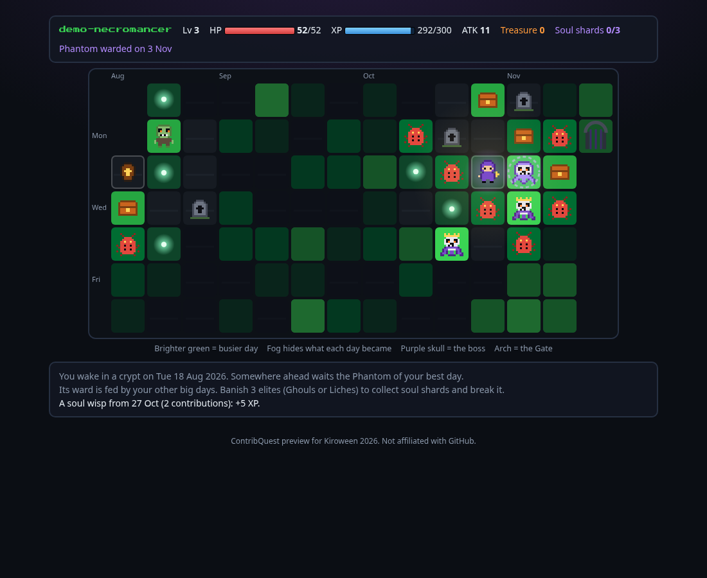

# ContribQuest: The Haunted Graph

Your GitHub graph is haunted. ContribQuest is a retro pixel-art RPG that raises your last 13 weeks of GitHub contributions as a playable map. Every day is a tile laid out exactly like your contribution graph. Busy days spawn monsters and treasure, your best day becomes the boss, and your streak powers your hero.

Built for [Kiroween 2026](https://kiroween.devpost.com/), Frankenstein category.

**Play:** https://winds-tech.github.io/contribquest/ (or [the demo](https://winds-tech.github.io/contribquest/?demo))



## Status

This repository currently holds the **design prototype**, created on 16 Nov 2026, inside the Kiroween submission period (30 Oct – 4 Dec 2026).

- `prototype/index.html` is a single-file, vibe-coded prototype used to test the game design and balance. It is not the final submission code.
- `docs/PRD.md` is the product requirements document (v1.4).
- The final build (TypeScript, Vite, Canvas 2D, built from Kiro specs in `/.kiro`) starts in Phase 0 and will replace the prototype at the site root.

## How to play

1. Enter a public GitHub username, or press **Play the demo**.
2. Move with the arrow keys or WASD (on-screen buttons on touch devices).
3. Fog hides what each day became. Walk close to reveal it.
4. Soul wisps and chests are picked up by walking onto them. Chests heal you.
5. Monsters start a turn-based fight: **A** to attack, **F** to flee. Every action is a timing test, pressed with **Space**:
   - **Strike:** press while the marker is in the gold zone for a critical hit.
   - **Dodge:** when a monster attacks, press as the red ring meets the gold circle. Only a perfect press dodges completely and lets you counter. A good press blocks most of the hit.
   - Turn on **Calm mode** (slower, wider windows) or **Auto-timing** on the hero screen if you prefer.
   - Each monster attacks its own way:
     - **Bug Imp** hits twice; the second hit is fast.
     - **Flaky Test Ghoul** freezes its ring part-way, then finishes. Pressing at the old pace is too early.
     - **Merge Conflict Lich** sends a dashed decoy ring with the real one. Only the solid ring counts.
     - **The Phantom** strikes twice. Below half HP it enters **Phase 2**: three faster strikes mixing every pattern.
6. Every chest offers a choice of **3 relics**. Keep one per chest, each at most once:

   | Relic | Effect |
   | --- | --- |
   | Rubber Duck | The first missed timing in each fight counts as Good |
   | Hotfix | Every perfect dodge heals 6% of max HP |
   | Force Push | Critical hits deal ×2.0 instead of ×1.6 |
   | Linter | The Perfect window is 25 ms wider |
   | Stack Overflow | +3 ATK |
   | Cold Brew | +10 max HP, and heal 10 now |
   | Git Blame | Counter-attacks deal full ATK instead of half |
   | Pair Programmer | Glancing blows deal ×0.8 instead of ×0.5 |
   | Code Review | Your lantern reveals and lights a wider area |
   | CI Cache | Fleeing with a Good press takes no damage |
7. The boss is the Phantom of your best day. It is warded until you banish 3 elites (Ghouls or Liches).
8. Defeat the Phantom, then walk into the Gate on your last day to win.

## How your data becomes the game

| Your GitHub data | In the game |
| --- | --- |
| Day with no contributions | Graveyard fog path |
| Lightest green day | Soul wisp (free XP) |
| Medium green day | Bug Imp or a small chest |
| Darker green day | Flaky Test Ghoul or a stocked chest |
| Darkest green day | Merge Conflict Lich (elite) |
| Your best day | The boss |
| Contributions in the last 91 days | Starting XP and level |
| Current streak | Streak Aura: +1 ATK, +5 HP, and a wider perfect-timing window per full week, up to 4 weeks |
| Your busiest weekday | A trait: +2 ATK when fighting in that weekday's row |

## Play with friends and come back tomorrow

- **Raid a friend's graph.** Fill in a friend's username under "Raid a friend's graph". Your hero is built from your graph, the map and the Phantom from theirs. Direct link: `?u=<you>&vs=<friend>`.
- **Challenge links.** "Copy challenge link" copies `?vs=<map owner>`. Whoever opens it enters their own username and raids that graph.
- **Today's tile.** If you contributed today you get the **Commit Blessing**: a free relic at the start of the run. If not, the **Uncommitted Curse** makes monsters hit 15% harder until you commit.
- **Trophies.** 12 trophies are saved in your browser across runs, for example *Zero Regressions* (beat the Phantom without taking damage) and *Graph Raider* (win a raid).
- **Share card.** "Save share card" downloads a 1200×630 PNG of your map and run stats, sized for social posts.

## Sound and effects

- All sound effects and the ambient score are synthesized in the browser with the Web Audio API. There are no audio files and no third-party music. Press **M** or use the footer button to mute.
- Effects include lantern lighting and drifting fog on the map, particle bursts, floating damage numbers, hit-stop on critical hits, slow motion on a perfect dodge, a boss intro, and a low-HP heartbeat.
- With `prefers-reduced-motion` turned on, screen shake, flashes, slow motion, and hop animations are off. The timing tests keep working.

## Data source and privacy

Contribution counts come from the open-source community API [grubersjoe/github-contributions-api](https://github.com/grubersjoe/github-contributions-api), which reads the public contribution calendar on a GitHub profile. This means:

- The username you enter is sent to that third-party service.
- Private contributions appear only if the user shows them on their profile.
- Data can lag GitHub by up to about an hour.
- Avatars load from `github.com/<username>.png`.

There is no ContribQuest server. The game saves your run and a one-hour data cache in your browser's local storage only. Demo mode makes no data requests.

## Run locally

The prototype is a static file with no build step:

```sh
python3 -m http.server 8000
# open http://localhost:8000/prototype/
```

## Credits

- Font: [Press Start 2P](https://fonts.google.com/specimen/Press+Start+2P) (SIL Open Font License).
- Sprites are drawn in code for this project.

ContribQuest is not affiliated with GitHub.

## License

[MIT](LICENSE)
